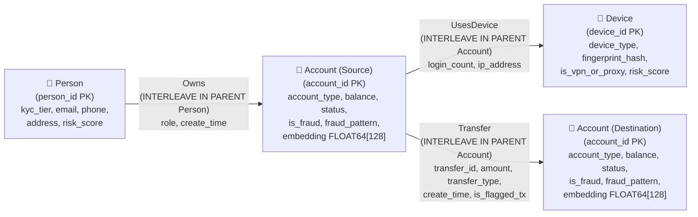
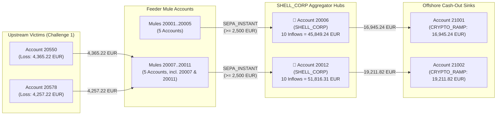
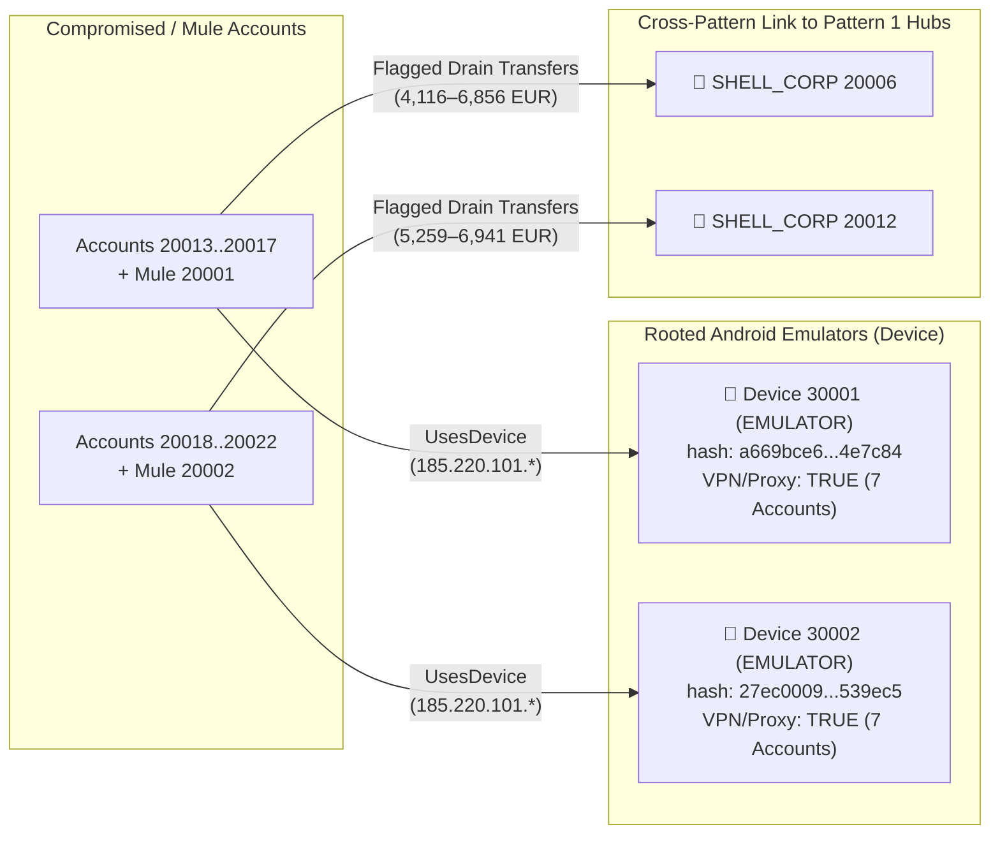
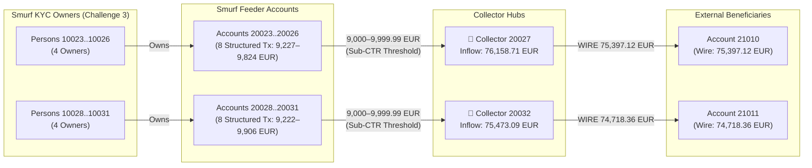
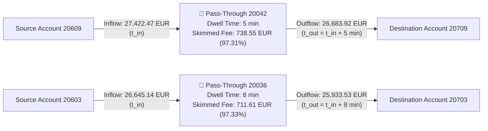
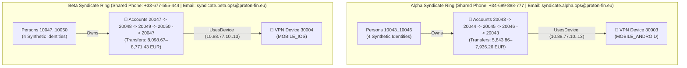
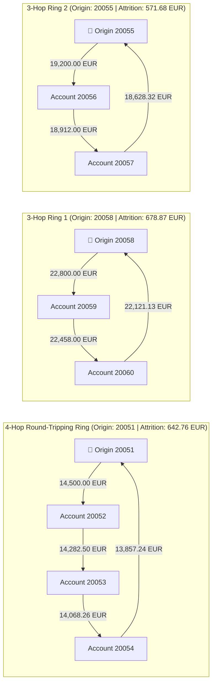
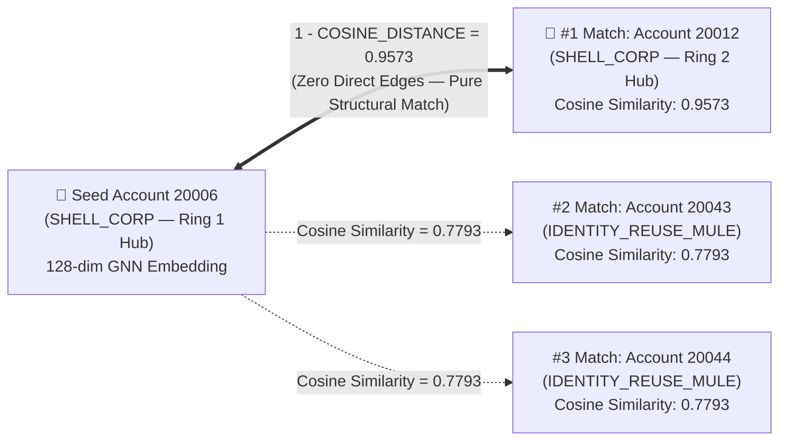

# End-to-End Financial Fraud Detection Workshop (Cloud Spanner Graph + BigQuery + GNN + MCP)

This repository ([https://github.com/mahurtado/fraud-detection](https://github.com/mahurtado/fraud-detection)) provides a complete, hands-on **Anti-Money Laundering (AML) & Financial Fraud Detection** workshop combining **BigQuery**, **Cloud Spanner Graph (`FraudGraph`)**, **2-Hop Heterogeneous GraphSAGE Graph Neural Networks (GNN)**, and **Model Context Protocol (MCP)** agentic investigation tools.

---

## 1. Architecture & Hybrid Data Flow

The diagram below illustrates how synthetic payment network data flows from this GitHub repository through Google Cloud Storage and BigQuery into **Cloud Spanner Graph (`FraudGraph`)**, and how analytical (`%%bqsql`), graph (`%%spanner_graph`), GNN (`dgf_gnn_pipeline.py`), and agentic (`mcp_fraud_server.py`) workloads operate over a single operational graph.

```mermaid
flowchart LR
    subgraph Repo["GitHub Repository (mahurtado/fraud-detection)"]
        CSV["data/*.csv\n(6 Node & Edge CSVs)"]
        Assets["assets/*\n(schema.sql, .py, .json, .md)"]
    end

    subgraph Storage["Google Cloud Storage"]
        GCS["gs://<YOUR_BUCKET>/data/*.csv"]
    end

    subgraph BQ["BigQuery (Analytical Engine)"]
        BQStage["Staging Dataset\n<YOUR_PROJECT_ID>.fraud_dataset"]
        BQRes["Enterprise Reservation\n(PIPELINE + QUERY Slots)"]
        BQExt["Zero-ETL External Schema\n<YOUR_PROJECT_ID>.fraud_spanner_external"]
        PCA["BigFrames ML 2D PCA\n(bigframes.ml.decomposition.PCA)"]
    end

    subgraph Spanner["Cloud Spanner Graph (Operational Engine)"]
        Nodes["Node Tables\nPerson (2,000)\nAccount (2,500 + 128d Embedding)\nDevice (1,800)"]
        Edges["Interleaved Edge Tables\nOwns (2,500)\nUsesDevice (2,518)\nTransfer (15,000)"]
        Graph["Property Graph: FraudGraph\n(ISO GQL + COSINE_DISTANCE)"]
    end

    subgraph AI["Graph ML & Agentic AI"]
        GNN["2-Hop GraphSAGE GNN\n(dgf_gnn_pipeline.py)"]
        MCP["MCP Investigation Server\n(mcp_fraud_server.py)"]
    end

    CSV -->|"Step 0.3: Auto-Sync"| GCS
    GCS -->|"Step 1: bq load"| BQStage
    Assets -->|"Step 4: gcloud spanner ddl update"| Graph
    BQStage -->|"Step 5: Reverse ETL\nEXPORT DATA (format='CLOUD_SPANNER')"| Nodes
    BQRes -.->|"Powers PIPELINE Job"| BQStage
    Nodes --- Edges
    Edges --- Graph
    Graph <-->|"Step 6: Zero-ETL\nCREATE EXTERNAL SCHEMA"| BQExt
    BQExt -->|"Step 9: Embedding Projection"| PCA
    Graph <-->|"Step 8: 2-Hop Message Passing &\n128-dim Embedding Write-Back"| GNN
    Graph <-->|"Step 10: JSON-RPC 2.0 Tools\n(investigate_account, detect_aml_pattern)"| MCP
```

---

## 2. Repository Structure

| Path | Description |
| :--- | :--- |
| [`README.md`](./README.md) | Workshop overview, architecture diagrams, example fraud graphs, and setup guide. |
| [`SPEC_FRAUD.md`](./SPEC_FRAUD.md) | Detailed technical specification reflecting the actual implementation state. |
| `assets/fraud_detection_workshop.ipynb`  | **End-to-End Interactive Notebook (83 cells, Sections `0`–`10`)** with `# @param` UI controls, automatic GitHub file download, BigQuery staging, Reverse ETL, `EXTERNAL_DATASET`, `%%spanner_graph` visual queries, 6 Student Challenges, GNN training, 2D PCA visualization, and MCP agent execution. |
| [`assets/CHALLENGE_SOLUTIONS.md`](./assets/CHALLENGE_SOLUTIONS.md) | Reference `%%spanner_graph` ISO GQL solutions and verified outputs for all **6 Student Challenges**. |
| [`assets/schema.sql`](./assets/schema.sql) | Cloud Spanner DDL for `Person`, `Account` (with `embedding ARRAY<FLOAT64>(vector_length=>128)`), `Device`, interleaved `Owns`, `UsesDevice`, `Transfer`, secondary indexes, and `CREATE OR REPLACE PROPERTY GRAPH FraudGraph`. |
| [`assets/queries_gql.sql`](./assets/queries_gql.sql) | Standalone ISO GQL queries for all 6 AML fraud patterns plus BigQuery-Spanner interoperability SQL (`EXTERNAL_DATASET`, `EXTERNAL_QUERY`, and `EXPORT DATA`). |
| [`assets/dgf_gnn_pipeline.py`](./assets/dgf_gnn_pipeline.py) | 2-Hop Heterogeneous GraphSAGE GNN pipeline that extracts `FraudGraph` topology, computes 128-dimensional L2-normalized embeddings, writes them back to `Account.embedding`, and outputs evaluation metrics. |
| [`assets/gnn_evaluation_report.json`](./assets/gnn_evaluation_report.json) | Model evaluation metrics (`Recall = 1.0000`, `Precision = 0.6593`, `F1 = 0.7947`) and top-10 cosine similarity neighbors for `SHELL_CORP` aggregator `20006`. |
| [`assets/mcp_fraud_server.py`](./assets/mcp_fraud_server.py) | Model Context Protocol (MCP) JSON-RPC 2.0 server exposing `get_fraud_graph_summary`, `detect_aml_pattern`, `investigate_account`, and `execute_readonly_gql`. |
| [`assets/generate_fraud_data.py`](./assets/generate_fraud_data.py) | Deterministic synthetic AML payment network generator (`seed = 42`) producing the 6 CSV files in `data/`. |
| [`assets/load_spanner_data.py`](./assets/load_spanner_data.py) | Direct Spanner REST mutation loader utility (alternative to BigQuery Reverse ETL). |
| [`data/`](./data/) | Synthetic dataset CSVs: `Person.csv` (`2,000` rows), `Account.csv` (`2,500` rows), `Device.csv` (`1,800` rows), `Owns.csv` (`2,500` rows), `UsesDevice.csv` (`2,518` rows), and `Transfer.csv` (`15,000` rows). |

---

## 3. Cloud Spanner Property Graph Schema (`FraudGraph`)

`assets/schema.sql` defines 3 node tables and 3 physically interleaved edge tables inside `FraudGraph` so that outgoing edges reside on the same storage split as their parent `Person` or `Account` node:

| Table Name | Graph Element | Row Count | Primary Key & Interleaving | Key Attributes |
| :--- | :--- | :--- | :--- | :--- |
| **`Person`** | `NODE` | `2,000` | `PRIMARY KEY (person_id)` | `full_name`, `email`, `phone`, `address`, `country`, `kyc_tier`, `risk_score`, `is_suspect` |
| **`Account`** | `NODE` | `2,500` | `PRIMARY KEY (account_id)` | `account_type`, `status`, `balance`, `country`, `is_fraud` (`60` fraud / `2,440` legit), `fraud_pattern`, `embedding ARRAY<FLOAT64>(vector_length=>128)` |
| **`Device`** | `NODE` | `1,800` | `PRIMARY KEY (device_id)` | `device_type`, `os_version`, `fingerprint_hash`, `ip_subnet`, `is_vpn_or_proxy`, `risk_score` |
| **`Owns`** | `EDGE` (`Person -> Account`) | `2,500` | `PRIMARY KEY (person_id, account_id)`, `INTERLEAVE IN PARENT Person` | `role`, `create_time` |
| **`UsesDevice`** | `EDGE` (`Account -> Device`) | `2,518` | `PRIMARY KEY (account_id, device_id)`, `INTERLEAVE IN PARENT Account` | `login_count`, `ip_address`, `last_used_time` |
| **`Transfer`** | `EDGE` (`Account -> Account`) | `15,000` | `PRIMARY KEY (account_id, to_account_id, transfer_id)`, `INTERLEAVE IN PARENT Account` | `amount`, `currency`, `transfer_type`, `create_time`, `step_num`, `is_flagged_tx` (`88` flagged), `fraud_pattern` |

---

## 4. Example Graphs for All 6 AML Fraud Topologies (`%%spanner_graph`)

Every fraud detection query in Section 7 of `assets/fraud_detection_workshop.ipynb` uses `%%spanner_graph` with `RETURN SAFE_TO_JSON(query_path) AS path_json, ...` to render interactive force-directed graphs alongside tabular metrics. Below are the exact topological subgraphs discovered in `FraudGraph`.

### Pattern 1: Money Mule Rings (`MONEY_MULE_RING` — Multi-Hop Fan-In / Fan-Out)

Two `SHELL_CORP` aggregator hubs (`20006` and `20012`) collect funds from mule accounts (`20001..20005` and `20007..20011`) and emulator-drained accounts (`20013..20022`), then wire consolidated payouts (`16,945.24 EUR` and `19,211.82 EUR`) to offshore sinks (`21001` and `21002`).

---

### Pattern 2: Shared Fraudulent Devices (`SHARED_FRAUD_DEVICE` — Device-Account Collusion)

Two rooted Android `EMULATOR` devices (`30001` and `30002`, `is_vpn_or_proxy = TRUE`) are shared across `7` distinct accounts each (`20013..20017` and `20018..20022` plus ring mules `20001` and `20002`). In **Challenge 2**, tracing outbound flagged transfers from these emulator-controlled accounts reveals that they drain directly into the Pattern 1 `SHELL_CORP` hubs (`20006` and `20012`)!

---

### Pattern 3: Structuring & Smurfing (`STRUCTURING_SMURFING` — Sub-10,000 EUR CTR Evasion)

Two groups of 4 smurf accounts (`20023..20026` and `20028..20031`) each execute 2 deposits structured just below the `10,000 EUR` regulatory reporting threshold (`9,222.40 EUR` to `9,906.20 EUR`) into collector accounts `20027` (`76,158.71 EUR` total) and `20032` (`75,473.09 EUR` total), which then wire out `75,397.12 EUR` and `74,718.36 EUR` to external beneficiaries `21010` and `21011`.

---

### Pattern 4: Rapid Cycling (`RAPID_CYCLING` — High-Velocity Pass-Through Accounts)

Ten pass-through accounts (`20033..20042`) receive large transfers (`16,182.13 EUR` to `27,422.47 EUR`) and forward `96.81%–98.06%` of the funds within **`5` to `11` minutes**, skimming a `1.9%–3.2%` laundering fee (**Challenge 4**).

---

### Pattern 5: Mule Networks & Identity Reuse (`IDENTITY_REUSE_MULE` — Shared PII + VPN Rings)

Eight "separate" `UNVERIFIED` `Person` records covertly reuse identical KYC contact attributes (`phone`, `email`, `address`) across two 4-account syndicates while routing `5,843.86–8,771.43 EUR` around their accounts and logging in from the same VPN devices (`30003` and `30004`, **Challenge 5**).

---

### Pattern 6: Circular & Loop Fund Flows (`CIRCULAR_LOOP` — 3-to-4 Hop Variable-Length Cycles)

Using the quantified path pattern `(origin:Account)-[t:Transfer WHERE t.amount >= 10000.0]->{3, 4}(origin:Account)` and chronological origin filtering (`t[0].create_time < t[ARRAY_LENGTH(t) - 1].create_time`, **Challenge 6**), `FraudGraph` isolates one 4-hop round-tripping ring (`20051..20054`) and two 3-hop triangles (`20055..20057` and `20058..20060`):

---

## 5. Predictive Graph ML — 2-Hop GNN Embeddings & `COSINE_DISTANCE`

`assets/dgf_gnn_pipeline.py` trains a **2-Hop Heterogeneous GraphSAGE** model over `FraudGraph`, writing `128`-dimensional L2-normalized vectors into `Account.embedding` (`ARRAY<FLOAT64>(vector_length=>128)`):
- **Node Classification Performance**: **`Recall = 1.0000` (`60 / 60` fraudulent accounts detected across all 6 patterns)**, **`Precision = 0.6593`**, **`F1 = 0.7947`** (`TP = 60`, `FP = 31`, `TN = 2,409`, `FN = 0`).
- **Structural `COSINE_DISTANCE` Discovery**: Querying `1.0 - COSINE_DISTANCE(seed.embedding, candidate.embedding)` for Money Mule Ring `SHELL_CORP` hub **`20006`** identifies **`20012`** (the counterpart `SHELL_CORP` hub of the second Money Mule Ring) as its **#1 nearest neighbor (`0.9573` cosine similarity)**—even though `20006` and `20012` share zero direct transfers!

---

## 6. Quickstart: Running the Workshop Notebook in Google Colab

1. Open the notebook in Google Colab: 
2. In **Section 0 (`0.1 Workshop Configuration Parameters`)**, fill in the `# @param` form fields:
   - `PROJECT_ID`: Your Google Cloud project ID.
   - `REGION`: `europe-west1` (default).
   - `BUCKET_NAME`: Your Google Cloud Storage bucket name for staging CSV data.
   - `GITHUB_REPO`: `https://github.com/mahurtado/fraud-detection` (default).
3. Run **Section 0 (`Step 0.2` & `Step 0.3`)** to authenticate, enable required GCP APIs, automatically download all workshop assets (`assets/*`) and synthetic CSVs (`data/*.csv`) from this GitHub repository, and stage `data/*.csv` to `gs://{BUCKET_NAME}/data/`.
4. Execute **Sections `1` through `10`** sequentially to complete the BigQuery staging, Spanner setup, DDL creation, Reverse ETL (`EXPORT DATA`), `EXTERNAL_DATASET` federation, all 6 `%%spanner_graph` fraud patterns & student challenges, 2-hop GNN training, 2D PCA visualization, and MCP investigation server calls.
